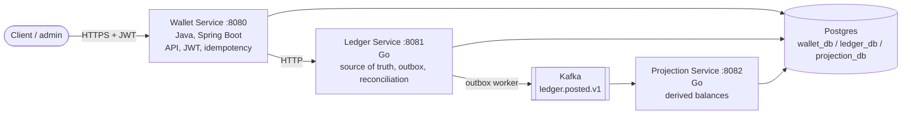

# ledger-platform

A double-entry wallet platform: users hold BRL wallets, move money between them, and an admin moves money in
and out. Three services (Java and Go), one Postgres, one Kafka topic.

The features are ordinary. The point is the guarantees, each one tested and checked while the system runs:

- **No money is created or destroyed**, including under concurrent transfers. Every ledger transaction nets to zero, enforced by a database constraint.
- **A retry never double-posts.** Writes carry an idempotency key, and the ledger transaction ID is derived from it.
- **Exactly-once projection.** The read-side balance applies each ledger entry once, in order, and can be rebuilt from the ledger.
- **Continuous reconciliation.** A job compares the ledger with the projection and reports drift.

**Why it is built this way.** The ledger is the only source of truth and is append-only by database permission. Balances are a derived, eventually consistent view, so the read path can fail or lag without touching the money. Each decision, with what was rejected, is an [ADR](docs/decisions/README.md).

## Architecture



Only the Wallet Service faces clients. The Ledger and Projection services are internal. More detail:
[architecture overview](docs/architecture/overview.md), [data flow](docs/architecture/data-flow.md), [ADR index](docs/decisions/README.md).

## Quick start

You need Docker (with Compose), Make, and `openssl` (the dev JWT script uses it). The Quick Demo also uses `curl`, `jq` and `uuidgen`.

```sh
make up        # build and start Postgres, Kafka and the three services
```

`make up` returns before the services are ready. Wait for all three:

```sh
for p in 8080 8081 8082; do
  until curl -sf localhost:$p/health/ready >/dev/null; do sleep 1; done
done; echo ready
```

| Service | Port | Called by |
|---|---|---|
| Wallet Service | 8080 | clients (JWT required) |
| Ledger Service | 8081 | Wallet Service; admin endpoints for debugging |
| Projection Service | 8082 | Wallet Service (rebuild only) |
| Postgres | 5432 | the services |
| Kafka | 9092 | the services |

`make down` stops the stack and deletes its volumes.

## Quick Demo

Run from the repo root, after the stack is ready. The first token script run creates a key pair in `keys/`.

```sh
# 1. Tokens: one user, one admin
USER_ID=00000000-0000-0000-0000-000000000001
TOKEN=$(./scripts/generate-jwt.sh $USER_ID 2>/dev/null)
ADMIN=$(./scripts/generate-jwt.sh $USER_ID admin 2>/dev/null)

# 2. Two wallets
mk() { curl -s -X POST localhost:8080/wallets -H "Authorization: Bearer $TOKEN" \
  -H "Content-Type: application/json" -d '{"currency":"BRL"}' | jq -r .walletId; }
A=$(mk); B=$(mk)

# 3. An admin deposit into A (the only way money enters)
curl -s -X POST localhost:8080/deposits -H "Authorization: Bearer $ADMIN" \
  -H "Idempotency-Key: $(uuidgen)" -H "Content-Type: application/json" \
  -d "{\"destinationWalletId\":\"$A\",\"amount\":\"500.00\"}" | jq

# 4. A transfer A -> B
curl -s -X POST localhost:8080/transfers -H "Authorization: Bearer $TOKEN" \
  -H "Idempotency-Key: $(uuidgen)" -H "Content-Type: application/json" \
  -d "{\"sourceWalletId\":\"$A\",\"destinationWalletId\":\"$B\",\"amount\":\"120.00\"}" | jq

# 5. Balances. They come from the projection, so wait for it to catch up.
until curl -s localhost:8080/wallets/$B/balance -H "Authorization: Bearer $TOKEN" \
  | jq -e '.balance == 120' >/dev/null; do sleep 1; done
curl -s localhost:8080/wallets/$A/balance -H "Authorization: Bearer $TOKEN" | jq
curl -s localhost:8080/wallets/$B/balance -H "Authorization: Bearer $TOKEN" | jq

# 6. The ledger rows for A and B (the deposit's matching debit is on the system funding account)
docker compose exec postgres psql -U ledger -d ledger -c \
  "SELECT transaction_id, account_id, entry_type, amount FROM ledger_db.ledger_entries
    WHERE account_id IN ('$A','$B') ORDER BY created_at, entry_type;"

# 7. The Kafka events for those two postings (on a stack that has seen other traffic, --from-beginning shows older ones first)
docker compose exec kafka /opt/kafka/bin/kafka-console-consumer.sh \
  --bootstrap-server kafka:29092 --topic ledger.posted.v1 --from-beginning --max-messages 2
```

The corrupt, reconcile and rebuild story is in the recorded transcript
[`docs/results/m6-reconciliation-drift.txt`](docs/results/m6-reconciliation-drift.txt): break a projection row by hand, watch reconciliation report it, rebuild it from the ledger.

## Results

- **Reconciliation and rebuild:** the [Milestone 6 transcript](docs/results/m6-reconciliation-drift.txt), recorded on a fresh local stack.
- **Load:** the harness is in place (`make load`, `make load-throughput`, `make load-spike`). Raw smoke-run output is in [`docs/results/load/`](docs/results/load/). These are short harness checks on a busy laptop, not a baseline. The baseline (Task 02) is not published yet.
- **Chaos drills:** not recorded yet (Task 04).
- **Trace screenshot:** not captured yet (Task 03).

Results will be added here with their environment and a link to the raw output. Nothing is quoted without one.

## Testing

- `make test` — unit + integration test suites for all three services (Testcontainers/dockertest manage their own ephemeral Postgres/Kafka; no `docker compose` stack required).
- `make up && make test-e2e` — end-to-end suite (`tests/e2e/`) against the full running stack. Requires `make up` first; never run by `make test` or CI.
- `make load`, `make load-throughput`, `make load-spike` — k6 load profiles, run in Docker against a running stack. Each ends with a reconciliation check that gates the result. Set `BASE_URL`, `LEDGER_URL`, `USER_TOKEN` and `ADMIN_TOKEN` to aim them at another deployment.
- `make lint` and `make fmt` — linters and formatters for every module.
- If `make test-e2e` fails with 401/403 errors, `keys/private.pem` and `keys/public.pem` are probably an out-of-sync pair. Regenerate both together with `rm -f keys/private.pem keys/public.pem && ./scripts/generate-jwt.sh 00000000-0000-0000-0000-000000000001`, then `docker compose restart wallet-service` if the stack was already running (so it picks up the new public key).

## Observability

```sh
make up-obs    # the stack plus Jaeger, Prometheus and Grafana
```

| Tool | URL |
|---|---|
| Grafana (dashboard: Transfers Overview) | http://localhost:3000 (anonymous viewer; admin / admin) |
| Jaeger (traces) | http://localhost:16686 |
| Prometheus | http://localhost:9090 |

`make down-obs` stops it. `scripts/verify-trace.sh` checks that a transfer produces one trace across all three services.

## Docs map

| Doc | What is in it |
|---|---|
| [`docs/SPEC.md`](docs/SPEC.md) | Requirements, data model, milestones |
| [`docs/architecture/`](docs/architecture/overview.md) | Overview and data flow, with diagrams |
| [`docs/decisions/`](docs/decisions/README.md) | Architecture decision records |
| [`docs/api/`](docs/api/README.md) | OpenAPI spec for the Wallet API |
| [`docs/api/testing-guide.md`](docs/api/testing-guide.md) | Tokens and curl examples |
