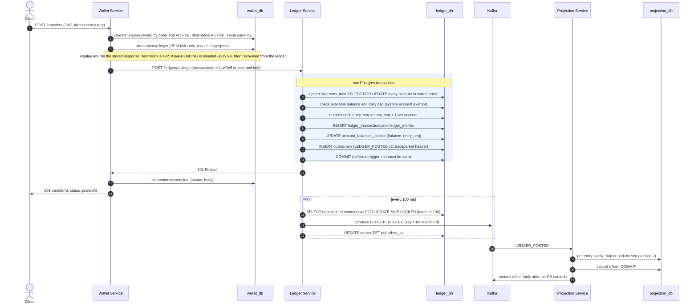
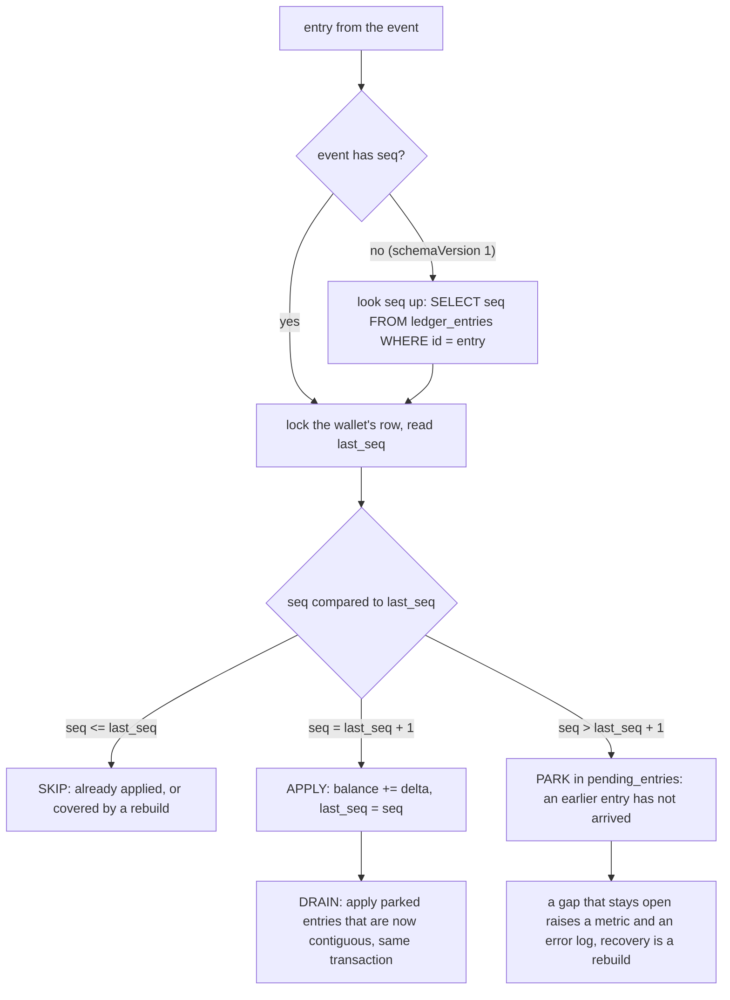
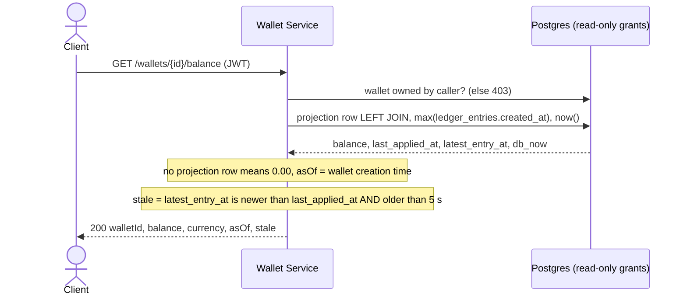
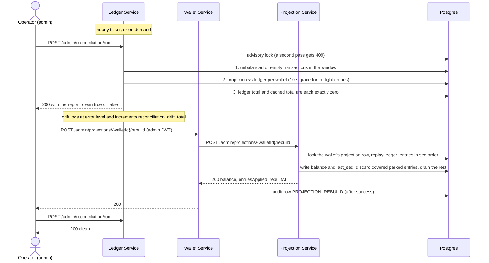

# Data flow

How a request moves through the system, and what happens when part of it fails. Read
[`overview.md`](overview.md) first for the components. Everything here is traced to the code; where a step has a
reason, the ADR is linked.

- [1. A transfer](#1-a-transfer)
- [2. How the projection applies an event](#2-how-the-projection-applies-an-event)
- [3. Reading a balance](#3-reading-a-balance)
- [4. Deposits and withdrawals](#4-deposits-and-withdrawals)
- [5. Reconciliation and rebuild](#5-reconciliation-and-rebuild)
- [Failure modes](#failure-modes)

## 1. A transfer

`POST /transfers` with a JWT and an `Idempotency-Key`. The synchronous half ends when the Ledger Service commits;
everything after that is asynchronous.

Notes on the steps:

- **Validation precedes the idempotency lookup** (`CreateTransferUseCase.execute`), so a replay of an old key
  after the source wallet has since been frozen or closed gets the validation error, not the stored `201`.
- **Locks cover every account in the posting**, debit and credit, in sorted order, so overlapping transactions
  cannot deadlock (ADR-0002). A transfer between two other wallets is never blocked by this one.
- **Ledger rejections** are returned as `409` (the same `transactionId` already posted: the stored original is
  returned), or `422` with a code (`INSUFFICIENT_FUNDS`, `DAILY_LIMIT_EXCEEDED`, `UNBALANCED`, `INVALID_AMOUNT`);
  the Wallet Service passes the code through and stores the outcome for replay (ADR-0011).
- **The outbox row is part of the posting transaction**, so an event exists if and only if the posting
  committed. The publish is at-least-once; the projection makes the duplicate harmless (section 2).
- **No `@Transactional` spans the ledger call** (ADR-0010): atomicity across the process boundary comes from the
  deterministic id (ADR-0006), the idempotency state machine and recovery via
  `GET /admin/ledger/transactions/{id}`.

## 2. How the projection applies an event

`LEDGER_POSTED` is keyed by transaction id over 12 partitions, so one wallet's events arrive in any order. Each
entry carries `seq`, its position in that wallet's history (ADR-0017). The consumer decides per entry:

All entries of one event, and the offset row, commit in **one** Postgres transaction; the Kafka offset is
committed after it. A crash in between redelivers the record and the redelivery is skipped.

If an apply fails (database error), the consumer **stops that partition at the failed record** and retries it
after a one-second backoff; other partitions keep flowing. Committing any later record would commit past the
failed one, because a Kafka commit is a per-partition high-water mark.

## 3. Reading a balance

`GET /wallets/{id}/balance` reads Postgres only (ADR-0007): the projection row and the newest ledger entry in
one statement, with the database's own clock.

An entry younger than five seconds is treated as in flight, not stale; a projection that has caught up is never
stale. The staleness threshold is the Wallet Service's policy, the projection only supplies facts.

## 4. Deposits and withdrawals

Money enters and leaves through a single system funding account, which is allowed to go negative (ADR-0008), so
that the whole platform nets to zero (NFR-CONS-5).

| | `POST /deposits` | `POST /withdrawals` |
|---|---|---|
| Caller | admin JWT only (ADR-0015) | admin JWT only |
| Entries | `DEBIT` system account, `CREDIT` the wallet | `DEBIT` the wallet, `CREDIT` system account |
| Wallet check | any `ACTIVE` BRL wallet, owner-agnostic; missing or inactive gives `422 WALLET_NOT_ACTIVE` | same |
| Insufficient funds | not applicable (system account is exempt) | `422 INSUFFICIENT_FUNDS` from the ledger |
| Response | `201 {transactionId, status, postedAt}` | same |

Both use the same idempotency lifecycle, deterministic transaction id and ledger call as a transfer
(`ExternalMovementUseCase`), and the system account is exempt from the daily cap (ADR-0011 amendment).

## 5. Reconciliation and rebuild

The reconciliation job proves the system agrees with itself; the rebuild repairs a projection that does not. They
never repair each other: detection and repair are deliberately separate, and the job holds only `SELECT` on the
projection.

The Projection Service has no authentication by design (ADR-0016): the Wallet Service owns the admin gate and the
audit event. The rebuild is exact while the consumer is lagging or running, because it takes the same row lock
as the consumer and writes the watermark the consumer then honours (ADR-0017). A recorded run of this whole
sequence is `docs/results/m6-reconciliation-drift.txt`.

## Failure modes

The SPEC §9 cases, the mechanism that handles each, and what proves it. "Drill" entries are
planned: `scripts/chaos.sh` (Milestone 7, Task 04) does not exist yet.

| SPEC | Failure | What happens | Mechanism | Proof |
|---|---|---|---|---|
| §9.1 | Wallet crashes after recording the key, before calling the ledger | Retry waits up to 5 s on the `PENDING` row, finds nothing posted, returns `409 IN_PROGRESS`; a janitor marks `PENDING` rows older than 60 s `FAILED`, freeing the key | Idempotency state machine, `IdempotencyJanitor` | `IdempotencyServiceTest.begin_pendingWithNoCompleter_waitsThenReturnsInProgress`, `CreateTransferUseCaseTest.inProgress_recoveryFindsNothing_throwsTransferInProgress`. Drill: planned, `scripts/chaos.sh` scenario 4 |
| §9.2 | Wallet crashes after the ledger committed, before answering | Retry re-derives the `transactionId`, asks the ledger, finds the commit, completes the record, returns `201` | Deterministic id (ADR-0006), `GET /admin/ledger/transactions/{id}` | `TransferControllerIT.pendingKeyAlreadyPostedByLedger_recoversAndReturns201`, `CreateTransferUseCaseTest.inProgress_recoveryFindsCommittedTransaction_completesAndReturns201`. Drill: planned, scenario 4 |
| §9.3 | Ledger crashes or is unreachable mid-transaction | Postgres rolls back: no entries, no outbox row. Wallet returns `503` + `Retry-After`, never `500`; client retries with the same key | Single DB transaction, `LedgerUnavailableException` mapping (NFR-AVAIL-2, 4) | `GlobalExceptionHandlerTest.handleLedgerUnavailable_returns503WithRetryAfterAndCode`, `ExternalMovementControllerIT.ledgerServiceDown_returns503WithRetryAfter`. Drill: planned, scenario 1 |
| §9.4 | Two transfers race on one wallet | The second blocks on the row lock, re-reads the new balance, fails `INSUFFICIENT_FUNDS` | `SELECT FOR UPDATE` (ADR-0002) | `TestPostingConcurrency`; `TestEntrySequence_ConcurrentPostingsToOneWallet` (gap-free numbering under the same race) |
| §9.5 | Kafka is down | Postings still commit; outbox rows accumulate and drain on recovery; balances report `stale` | Transactional outbox, worker retries each tick (NFR-AVAIL-5) | `TestOutboxWorker_KafkaDown_RowsStayPending`; e2e `RebuildDuringConsumerLagDoesNotDoubleCount` (stops Kafka). Alert `OutboxBacklog` and drill: planned (Tasks 03, 04) |
| §9.6 | Projection crashes mid-event | On restart it re-reads from the last committed offset; the re-applied entry is skipped by `seq` | Offset committed after the DB commit (NFR-AVAIL-3), per-wallet sequence (ADR-0017) | `TestConsumer_DuplicateDelivery_IsNoOp`, projection `TestEntrySequence`. Drill: planned, scenario 3 |
| §9.7 | Projection drifts from the ledger | Reconciliation reports the wallet with both numbers; an admin rebuilds it | Reconciliation job, audited rebuild (ADR-0016) | e2e `TestE2E_ProjectionRebuild`; `docs/results/m6-reconciliation-drift.txt` |
| §9.8 | The same event is delivered twice | The second delivery is skipped (`seq <= last_seq`) | ADR-0017 | `TestConsumer_DuplicateDelivery_IsNoOp`, `TestEntrySequence/a rebuild during consumer lag…` |
| §9.9 | Postgres is down | Wallet and Ledger return `503`. The consumer stops the affected partition at the failed event and retries it with a backoff until the database returns | Failure-stops-partition consumer loop | `TestConsumer_FailedApply_StopsThePartitionAndRetries`, `TestConsumer_FailedApply_OtherPartitionsKeepFlowing` |
| §9.10 | Clock skew between services | Time-based decisions use Postgres `now()`: the `stale` comparison, reconciliation's grace window, `parked_at` | Database clock (SPEC §9.10) | `BalanceJdbcRepositoryIT` (staleness from the DB clock). Exception: `occurredAt` in the event is the Ledger's Go clock and feeds only the lag metric |
| §9.11 | Events for one wallet arrive out of order | Entries ahead of a gap are parked, then applied in order when it fills; a gap that never fills is reported | ADR-0017 | Projection `TestEntrySequence/out-of-order delivery…`; live check of 516 reordered events in Milestone 6 |

A failure this design does not cover: a *permanent* apply failure for one event holds its partition until someone
intervenes (it is visible as consumer lag and a repeating warning). Setting such an event aside safely is designed
and deferred (Milestone 6, Task 08 follow-up).
