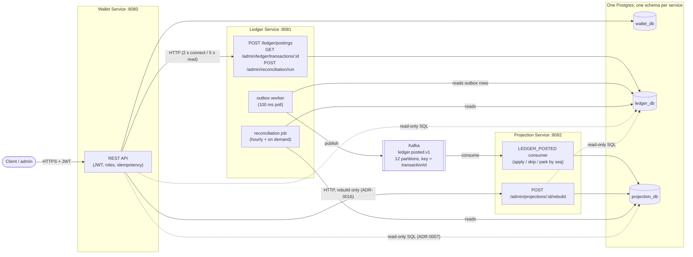

# Architecture overview

A double-entry wallet platform: users hold BRL wallets, move money between them, and an admin moves money in
and out. Three services, one Postgres, one Kafka topic. The point of the project is not the features but the
guarantees: **money is never created or destroyed, a retry never double-posts, a derived balance can always be
rebuilt from the ledger, and the system checks itself continuously.**

This page is the map. `data-flow.md` follows a request through it; every decision has an ADR, indexed in
[`../decisions/README.md`](../decisions/README.md); the normative requirements are in [`../SPEC.md`](../SPEC.md).

## Services

| Service | Stack | Owns (schema in the one Postgres) | Responsible for |
|---|---|---|---|
| **Wallet Service** `:8080` | Java 26, Spring Boot 4.0.6, Flyway | `wallet_db`: `wallets`, `idempotency_records`, `wallet_audit_log` | The only API clients call. JWT (RS256) authentication and the admin role, wallet lifecycle (freeze / unfreeze / close), the idempotency lifecycle, orchestrating a transfer, `GET /balance` (including the `stale` flag), deposits and withdrawals (admin), the admin rebuild proxy and its audit row. It owns *policy*; it stores no balances. |
| **Ledger Service** `:8081` | Go, Gin, pgx, golang-migrate | `ledger_db`: `ledger_transactions`, `ledger_entries` (append-only), `account_balances_locked`, `outbox` | The source of truth. Posts balanced transactions atomically under per-account row locks, enforces the double-entry invariant, the overdraft and daily-cap rules, numbers each account's entries, writes the outbox row in the same transaction, runs the outbox worker and the reconciliation job. Internal: no auth, trusts its caller. |
| **Projection Service** `:8082` | Go, Gin, franz-go | `projection_db`: `wallet_balances`, `pending_entries`, `projection_offsets` | The derived, eventually consistent balance. Consumes `LEDGER_POSTED`, applies each entry exactly once, and can rebuild one wallet from the ledger. Internal: no auth. |
| Notification Service | Go | none | Optional and not built (SPEC §5.2): no compose service. |

Plus Kafka (`apache/kafka`, KRaft, one broker) and, as an overlay (`make up-obs`), Jaeger v2, Prometheus and Grafana.
Kafka topic `ledger.posted.v1` has 12 partitions and is keyed by transaction ID.

## Component diagram

Solid lines are calls and writes; dotted lines are the cross-schema **read-only** grants below. No service ever
writes another service's schema.

### Who may read what

Each service's migration set grants *its own* objects to the other roles (ADR-0004, 2026-11-14 amendment).

| Role | Reads (beyond its own schema) | Why |
|---|---|---|
| `wallet_app` | `projection_db.wallet_balances`, `ledger_db.ledger_entries` | The balance + freshness join and the close-wallet check (ADR-0007). |
| `projection_app` | `ledger_db.ledger_entries` | The rebuild replays the ledger. |
| `ledger_app` | `projection_db.wallet_balances` | The reconciliation job compares projections to the ledger; read-only by test, so the job can report drift but never "fix" it. |

`ledger_app` cannot `UPDATE` or `DELETE` ledger entries or transactions at all (ADR-0003): the audit record is
append-only by Postgres permission, not by convention.

## Correctness guarantees, and where each one lives

| Guarantee | Mechanism | ADR / SPEC | Verified by |
|---|---|---|---|
| Every transaction nets to zero | Deferred constraint trigger `trg_check_balance` aborts an unbalanced commit; the application pre-checks too | SPEC §3.2 | Ledger tests (`TestPostingRepository`, TST-INT-5); the reconciliation invariant check |
| No overdraft, no lost update under concurrency | `SELECT … FOR UPDATE` on every account in a posting, in sorted order, in the posting transaction | ADR-0002 | `TestPostingConcurrency`; `TestDisjointPairsDontBlock` (disjoint wallets never block) |
| A retry never double-posts | Idempotency record per `(user, key)` + request fingerprint; `transactionId` derived from the key, so a crashed request can ask the ledger "did this commit?" | ADR-0006, ADR-0009, ADR-0010 | `TransferControllerIT`, `CreateTransferUseCaseTest`, e2e `IdempotentReplay`, `DepositIdempotency` |
| An event is published iff the posting committed | Transactional outbox: the outbox row is written in the posting transaction; a worker publishes and marks it | SPEC §7.5 | `TestOutboxWorker_*`; e2e `HappyPath` |
| The projection applies every entry exactly once, in any arrival order | Per-account `seq` from the ledger; the projection applies `last_seq + 1`, skips old, parks ahead of a gap | ADR-0017 | Projection `TestEntrySequence*`; e2e `RebuildDuringConsumerLagDoesNotDoubleCount` |
| A failed apply is never silently skipped | The consumer stops that partition at the failed record and retries it | SPEC §9.9 | `TestConsumer_FailedApply_*` |
| A wrong projection is detected and repairable | Reconciliation (invariant, projection drift, money supply = 0) + admin rebuild, audited | SPEC §7.6, §9.7, ADR-0016 | e2e `ProjectionRebuild`; reconciliation tests |
| Money supply is zero | The system funding account may overdraw (ADR-0008); reconciliation asserts the ledger total and the cached total are each exactly zero | NFR-CONS-5 | e2e `MoneySupplyHoldsAfterExternalMovements` |
| Every wallet status change and rebuild is attributable | `wallet_audit_log` row with actor, before/after | NFR-AUDIT-3 | e2e `CloseWalletRules`, `ProjectionRebuild` |

## Failure behaviour in one paragraph

Wallet → Ledger being unreachable gives the client `503` + `Retry-After`, never `500` (NFR-AVAIL-4). A
ledger crash mid-transaction leaves nothing (Postgres rolls back). Kafka down: postings still commit, rows wait
in the outbox and drain on recovery (NFR-AVAIL-5); balances report `stale`. A projection crash loses nothing
because offsets are committed only after the projection write. The full table, with the mechanism and the test or
drill for each SPEC §9 case, is in [`data-flow.md`](data-flow.md#failure-modes).

## Observability

Structured JSON logs with `trace_id`/`span_id`; W3C `traceparent` propagated across HTTP and carried through the
outbox row and the Kafka header so one trace spans `POST /transfers` through to the projection write
(ADR-0013, ADR-0014). `/metrics` on every service (Prometheus), the Grafana dashboard `Transfers Overview`, and
Jaeger. `make up-obs` adds the three containers; the base compose points the services at `jaeger:4317` whether or
not the overlay is running (ADR-0014, 2026-11-14 amendment).

## Where to go next

- [`data-flow.md`](data-flow.md): the transfer, the read path, deposits, reconciliation, rebuild, and failure modes.
- [`../decisions/README.md`](../decisions/README.md): every decision and its status.
- [`../SPEC.md`](../SPEC.md): requirements, schemas, event contracts.
- `docs/results/`: load, chaos and demo evidence.
